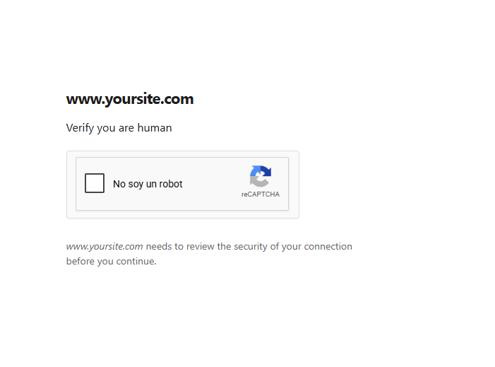
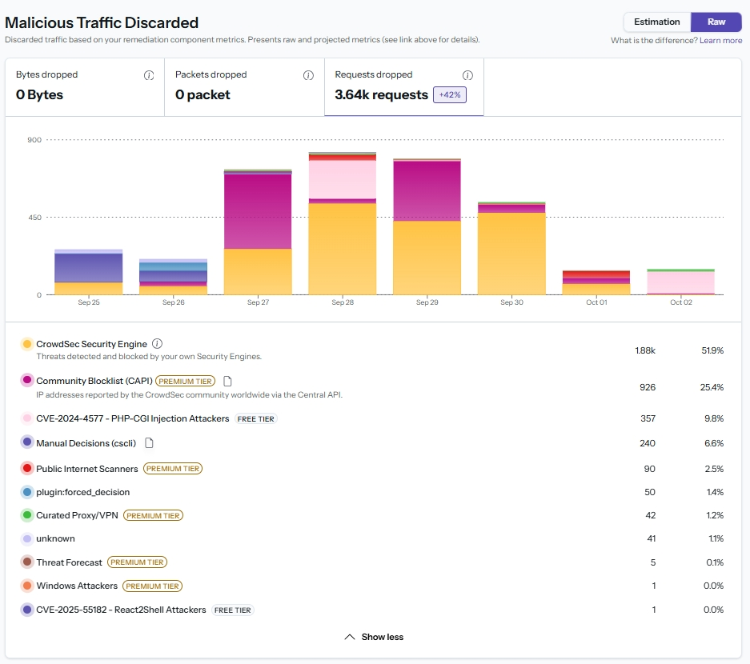
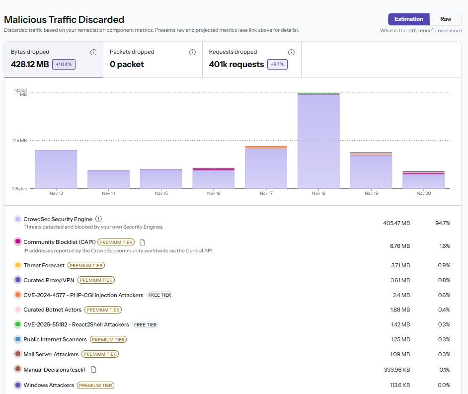
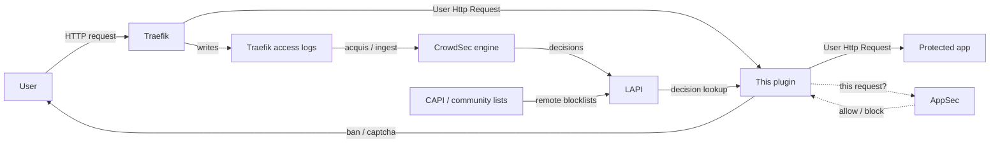

[](https://github.com/david-garcia-garcia/crowdsec-bouncer-traefik-plugin/actions)

# Crowdsec Bouncer Traefik plugin

## What this plugin is

A CrowdSec bouncer for Traefik. For every request it decides, based on CrowdSec, whether to let the visitor through, ban them, or show them a captcha. Decisions come from community blocklists, your own CrowdSec detections, and (optionally) the CrowdSec AppSec WAF.

It is a rewrite of [maxlerebourg/crowdsec-bouncer-traefik-plugin](https://github.com/maxlerebourg/crowdsec-bouncer-traefik-plugin). What changed:

- **AI-first.** OpenSpec specs, a knowledge base, and intensive test coverage, including mock and real-stack harnesses.
- **Detailed metrics in CrowdSec.** Blocked requests and their estimated bytes are reported per decision origin and per blocklist, so they show up broken down in `cscli metrics` and the CrowdSec Console. See [LAPI metrics reporting](https://github.com/david-garcia-garcia/crowdsec-bouncer-traefik-plugin/blob/master/docs/concepts.md#lapi-metrics-reporting).
- **reCAPTCHA Enterprise.** Checkbox and score keys, plus classic reCAPTCHA, hCaptcha, Turnstile, and custom widgets.
- **EU CAPTCHA.** Provider `eucaptcha`.
- **Self-hosted custom captchas.** With `captchaProvider: custom`, the widget script and challenge endpoint (`captchaCustomJsUrl`, `captchaCustomChallengeUrl`) can sit behind the protected router: visitors waiting for a captcha can still load them. The answer can also be validated with a JSON body (`captchaCustomValidateBody: json`), as [Cap](https://capjs.js.org/) expects. See [Captcha settings](https://github.com/david-garcia-garcia/crowdsec-bouncer-traefik-plugin/blob/master/docs/configuration.md#captcha).
- **Captcha passes stored on the visitor.** A solved captcha is remembered with a signed cookie on that browser (optionally tied to its IP). The original plugin whitelisted the IP on the server, so one solve let in every browser behind that address, and multi-instance setups needed Redis to share it.
- **No Redis needed.** The recommended setup keeps decisions in memory. Redis is only useful for the `live` LAPI mode with several Traefik replicas.
- **Per-router settings.** Each router keeps its own status code, captcha, trusted IPs, and behavior when CrowdSec is down. The original plugin shared one set of settings across every CrowdSec middleware in Traefik.
- **Captcha when CrowdSec is down.** `bouncerLapiFailureAction` and `bouncerAppsecFailureAction` choose `ban`, `passthrough`, or `captcha` when LAPI or AppSec cannot answer. The original plugin could only block or let the request through. See [Choose what happens when CrowdSec is down](https://github.com/david-garcia-garcia/crowdsec-bouncer-traefik-plugin/blob/master/docs/how-to/crowdsec-down.md).
- **Soften a ban per origin with `bouncerOriginBasedDecisionRemap`.** On one router, turn a ban from a chosen origin into a captcha or a pass: the community blocklist, every blocklist, or one named list. Other routers sharing the same LAPI connection keep the original ban. See [Show a community ban as a captcha](https://github.com/david-garcia-garcia/crowdsec-bouncer-traefik-plugin/blob/master/docs/how-to/community-ban-as-captcha.md).
- **Several CrowdSec engines** in one Traefik, each with its own API key, or several routers sharing one engine. See [Middleware Architecture](https://github.com/david-garcia-garcia/crowdsec-bouncer-traefik-plugin/blob/master/docs/middleware-architecture.md).
- **Config reloads apply.** Changing the LAPI host, key, mode, interval, or any other setting takes effect on a Traefik configuration reload. The original plugin kept the first values until Traefik restarted.
- **IP, IP range, country, ASN, and custom scopes.** The original plugin matched the client IP only.
- **Forwarded IP header trusted only from listed proxies.** With `bouncerForwardedHeadersTrustedIps` empty, the plugin checks the connecting IP; reading the header from any peer requires `bouncerForwardedHeadersInsecure`. The original plugin read the header from any peer when that list was empty. See [Remediate the visitor, not the proxy](https://github.com/david-garcia-garcia/crowdsec-bouncer-traefik-plugin/blob/master/docs/how-to/behind-proxy.md).
- **AppSec independent of the LAPI mode.** A router can run the WAF, the decision lookup, or both.
- **Client certificates for AppSec.** `appsecTlsClientCertificate` and `appsecTlsClientKey` authenticate the plugin to AppSec with mTLS, as LAPI already allowed. The original plugin did not support mTLS for AppSec. See [Use HTTPS to communicate with the Appsec](https://github.com/david-garcia-garcia/crowdsec-bouncer-traefik-plugin/blob/master/docs/connect-to-crowdsec.md#use-https-to-communicate-with-appsec).
- **Separate timeouts.** LAPI, AppSec, and captcha validation each have their own (`lapiHttpTimeoutSeconds`, `appsecHttpTimeoutSeconds`, `captchaSiteverifyHttpTimeoutSeconds`), so a short AppSec timeout does not cut LAPI calls short. The original plugin used one `httpTimeoutSeconds` for all three.
- **Permanent rules with `bouncerActionRules`.** Ban, captcha, or skip checks for requests matching a path, host, method, header, or cookie, without any CrowdSec decision. For example, always show a captcha to a whole country or region by matching a country header such as `CF-IPCountry`, or skip all checks for a specific host. See [bouncerActionRules](https://github.com/david-garcia-garcia/crowdsec-bouncer-traefik-plugin/blob/master/docs/configuration.md#bounceractionrules).
- **No captcha on API routes with `bypassCaptcha`.** A `bouncerActionRules` action for requests that cannot solve a captcha, such as API calls from another server: where a captcha would be served, the request goes through. Bans still apply. See [Keep captchas off API routes](https://github.com/david-garcia-garcia/crowdsec-bouncer-traefik-plugin/blob/master/docs/how-to/captcha-off-api-routes.md).
- **Detailed verdict header.** `bouncerRemediationHeadersCustomName` now tells not only what was done (ban or captcha) but why and from where: a CrowdSec decision and its origin (`ban:lapi:CAPI`, `ban:lapi:lists_firehol_level1`), AppSec, a rule, or an outage of LAPI or AppSec. Add it to your access logs to trace every blocked request back to its cause. The original plugin only sent `ban` or `captcha`. See [See the verdict in access logs](https://github.com/david-garcia-garcia/crowdsec-bouncer-traefik-plugin/blob/master/docs/how-to/verdict-in-access-logs.md).

> [!TIP]
>
> **Traefik Security**
>
> The basic middlewares you need to secure your Traefik ingress:
>
> - 🌍 **Geoblock**: [david-garcia-garcia/traefik-geoblock](https://github.com/david-garcia-garcia/traefik-geoblock) - Block or allow requests based on IP geolocation
> - 🛡️ **CrowdSec**: [david-garcia-garcia/crowdsec-bouncer-traefik-plugin](https://github.com/david-garcia-garcia/crowdsec-bouncer-traefik-plugin) - Real-time threat intelligence and automated blocking
> - 🔒 **ModSecurity CRS**: [david-garcia-garcia/traefik-modsecurity](https://github.com/david-garcia-garcia/traefik-modsecurity) - Web Application Firewall with OWASP Core Rule Set
> - 🚦 **Ratelimit**: [Traefik Rate Limit](https://doc.traefik.io/traefik/reference/routing-configuration/http/middlewares/ratelimit/) - Control request rates and prevent abuse

> [!WARNING]
>
> **Do not run middlewares as Yaegi plugins in production.**
>
> Traefik's catalog loads plugins with [Yaegi](https://github.com/traefik/yaegi), a Go interpreter. A middleware runs on every request, so the interpreter's cost lands on every request too: memory, CPU, and observability ([Yaegi #1712](https://github.com/traefik/yaegi/pull/1712)). For real traffic, compile the middleware into the Traefik binary, for example with [traefik-with-plugins](https://github.com/david-garcia-garcia/traefik-with-plugins). Discussion: [Traefik #12213](https://github.com/traefik/traefik/issues/12213).

## What it looks like

The captcha page that ships with the plugin: the site name, a verify-you-are-human prompt, and the provider widget (hCaptcha, reCAPTCHA, reCAPTCHA Enterprise, Turnstile, EU CAPTCHA, or your own).



What the plugin blocked, reported back to CrowdSec per decision origin and shown in the CrowdSec Console:



The Console also shows the estimated bytes dropped per origin:



## What CrowdSec is


> [CrowdSec](https://www.crowdsec.net/) is an open-source and collaborative IPS (Intrusion Prevention System) and a security suite.
> We leverage local behavior analysis and crowd power to build the largest CTI network in the world.

CrowdSec also provides the community blocklist: IPs that are widely reported and validated as malicious across the CrowdSec network. LAPI, CAPI, AppSec and the other CrowdSec terms are explained in [Concepts](https://github.com/david-garcia-garcia/crowdsec-bouncer-traefik-plugin/blob/master/docs/concepts.md#what-crowdsec-is).

## Architecture diagram



Users are blocked based on:

- Remote decisions (threat intelligence)
- Local decisions from inspecting your Traefik access logs and identifying attack patterns
- AppSec WAF

This plugin only enforces decisions. It does not read logs; CrowdSec does that and produces the decisions.

To share one CrowdSec connection between routers, or to use several CrowdSec engines in one Traefik, see [Middleware architecture](https://github.com/david-garcia-garcia/crowdsec-bouncer-traefik-plugin/blob/master/docs/middleware-architecture.md).

## Quick start

To try it locally, use the `docker-compose.yml` file of this repository. Set a LAPI key first ([Generate a LAPI key](https://github.com/david-garcia-garcia/crowdsec-bouncer-traefik-plugin/blob/master/docs/connect-to-crowdsec.md#generate-a-lapi-key)), then run:

```bash
make run
```

In your own Traefik, declare the plugin in the static configuration:

```yaml
experimental:
  plugins:
    bouncer:
      moduleName: github.com/david-garcia-garcia/crowdsec-bouncer-traefik-plugin
      version: vX.Y.Z # a tag from https://github.com/david-garcia-garcia/crowdsec-bouncer-traefik-plugin/releases
```

Then add a middleware to your routers in the dynamic configuration. `stream` is the recommended mode:

```yaml
http:
  middlewares:
    crowdsec:
      plugin:
        bouncer:
          bouncerEnabled: true
          lapiEnabled: true
          lapiHost: crowdsec:8080
          lapiKey: FIXME-LAPI-KEY
          lapiMode: stream
```

To add the WAF, set `appsecEnabled: true`. To serve captchas, see [Captcha settings](https://github.com/david-garcia-garcia/crowdsec-bouncer-traefik-plugin/blob/master/docs/configuration.md#captcha).

> [!WARNING]
> AppSec only receives the first 10 MB of a request body by default (`appsecBodyLimit`).

## Documentation

<a name="usage"></a><a name="variables"></a><a name="configuration"></a><a name="what-you-can-do"></a><a name="decisions"></a><a name="remediation"></a><a name="appsec"></a><a name="lapi-modes"></a><a name="cache"></a><a name="middleware-architecture"></a>

The full documentation is in [docs/](https://github.com/david-garcia-garcia/crowdsec-bouncer-traefik-plugin/blob/master/docs/README.md).

| I want to… | Read |
| ---------- | ---- |
| Understand decisions, ban and captcha, AppSec, LAPI modes, metrics and cache | [Concepts](https://github.com/david-garcia-garcia/crowdsec-bouncer-traefik-plugin/blob/master/docs/concepts.md) |
| Look up a setting | [Configuration reference](https://github.com/david-garcia-garcia/crowdsec-bouncer-traefik-plugin/blob/master/docs/configuration.md) |
| Protect several routers or use several CrowdSec engines | [Middleware architecture](https://github.com/david-garcia-garcia/crowdsec-bouncer-traefik-plugin/blob/master/docs/middleware-architecture.md) |
| Set up the LAPI key, client certificates or HTTPS | [Connect to CrowdSec](https://github.com/david-garcia-garcia/crowdsec-bouncer-traefik-plugin/blob/master/docs/connect-to-crowdsec.md) |
| Test a ban or a captcha | [Test a ban or a captcha](https://github.com/david-garcia-garcia/crowdsec-bouncer-traefik-plugin/blob/master/docs/how-to/test-ban-or-captcha.md) |
| Run behind Cloudflare or another proxy | [Remediate the visitor, not the proxy](https://github.com/david-garcia-garcia/crowdsec-bouncer-traefik-plugin/blob/master/docs/how-to/behind-proxy.md) |
| Choose what happens when CrowdSec is down | [CrowdSec down](https://github.com/david-garcia-garcia/crowdsec-bouncer-traefik-plugin/blob/master/docs/how-to/crowdsec-down.md) |
| Keep captchas off API routes | [bypassCaptcha](https://github.com/david-garcia-garcia/crowdsec-bouncer-traefik-plugin/blob/master/docs/how-to/captcha-off-api-routes.md) |
| See every other task | [How-to guides](https://github.com/david-garcia-garcia/crowdsec-bouncer-traefik-plugin/blob/master/docs/how-to/README.md) |
| Run the tests or load the plugin from a checkout | [Development](https://github.com/david-garcia-garcia/crowdsec-bouncer-traefik-plugin/blob/master/docs/development.md) |

## Examples

Runnable setups for Cloudflare, Redis, trusted IPs, a binary VM, TLS authentication, Kubernetes, standalone mode, AppSec, captcha, custom ban and captcha pages, and country decisions: see the [list of examples](https://github.com/david-garcia-garcia/crowdsec-bouncer-traefik-plugin/blob/master/docs/README.md#examples).
