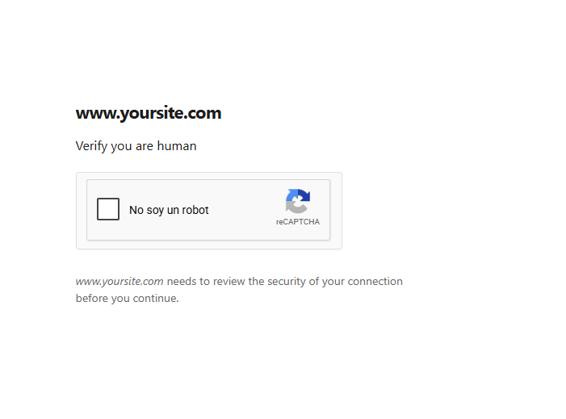
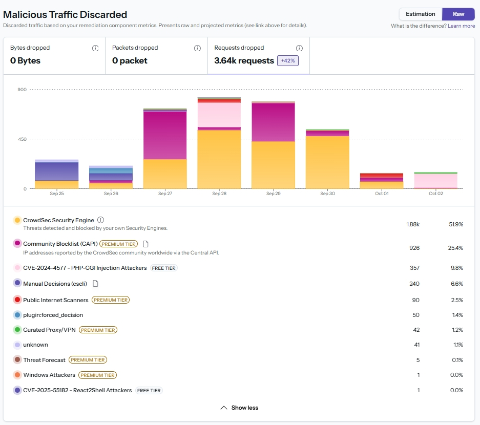
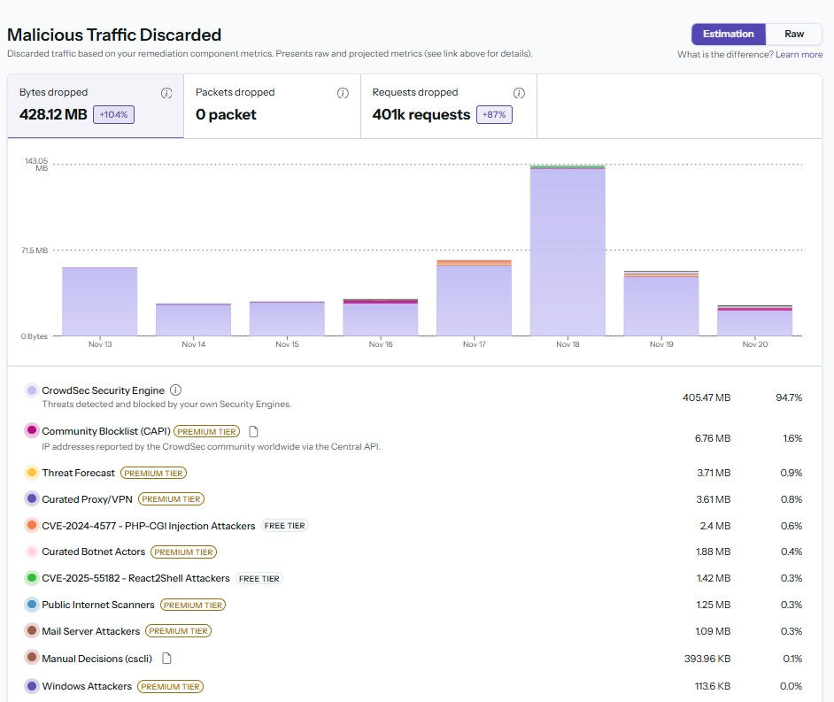

[Documentation](README.md) › Concepts

# Concepts

How CrowdSec and this plugin work together: what a decision is, what the visitor gets, how decisions reach the plugin, and what it reports back.

## What CrowdSec is

> [CrowdSec](https://www.crowdsec.net/) is an open-source and collaborative IPS (Intrusion Prevention System) and a security suite.
> We leverage local behavior analysis and crowd power to build the largest CTI network in the world.

CrowdSec also provides the community blocklist: IPs that are widely reported and validated as malicious across the CrowdSec network.

A few CrowdSec terms used in this documentation:

- **LAPI** (Local API): the CrowdSec service that stores decisions ("ban this IP for 4 hours"). This plugin reads decisions from it.
- **CAPI** (Central API): CrowdSec's cloud service that distributes the community blocklist.
- **AppSec**: CrowdSec's WAF component. It inspects a single request and answers allow or block.
- **ModSec**: an optional OWASP ModSecurity CRS sidecar this plugin inspects against, separate from CrowdSec AppSec.
- **Bouncer**: a component that enforces decisions. This plugin is a bouncer.

This plugin only enforces decisions. It does not read logs; CrowdSec does that and produces the decisions.

## Decisions

A CrowdSec decision says *who* (the scope, e.g. an IP) and *what to do* (the remediation, e.g. ban).

Supported scopes:

- `Ip`: the client IP.
- `Range`: an IP range (CIDR) that contains the client IP.
- Any other scope (country, ASN, username, …) read from a request header you configure in `bouncerDecisionScopeHeaders`.

`bouncerDecisionScopeHeaders` maps a CrowdSec **scope name** (the key) to the **request header** that holds the value (the value). The key also decides how the header is compared:

- `Country` (any case): two-letter ISO country code, case-insensitive. Cloudflare's `XX` and `T1` never match. Example headers: `CF-IPCountry`, or `X-IPCountry` from a geolocation middleware.
- `AS` (any case): ASN number. A leading `AS` (as in `AS13335`) is ignored. Example header: `CF-ASN`.
- Any other key (`username`, `session`, …): the header value, trimmed, compared exactly. The key must match the scope name stored in CrowdSec (`username` is not `user`).
- `Ip` and `Range` cannot be mapped to a header; they always use the client address.

```yaml
bouncerDecisionScopeHeaders:
  Country: X-IPCountry
  AS: CF-ASN
  username: X-User
```

The plugin does not geolocate. Header values are used as received, so they must come from something you trust: a CDN, a reverse proxy, or an earlier Traefik middleware such as [traefik-geoblock](https://github.com/david-garcia-garcia/traefik-geoblock). If visitors can set the header themselves, they can dodge or trigger these decisions. A complete example is in [examples/geoenrich-decisions](../examples/geoenrich-decisions/README.md). To also download those decisions in `stream` mode, see [Match a country or an ASN](how-to/country-or-asn.md).

## Remediation

What the visitor gets for each CrowdSec remediation ([CrowdSec bouncers](https://docs.crowdsec.net/u/bouncers/intro)):

| Remediation | What the user gets |
| ----------- | ------------------ |
| `ban`       | A ban page (or an empty body) with status `bouncerRemediationStatusCode` (default 403). An AppSec ban keeps the `http_status` CrowdSec sends instead: 403 by default, 429 for a `RateLimit()` block, or the code set with `user_blocked_http_code` or `SetReturnCode()`. |
| `captcha`   | A captcha page. Once solved, the visitor is redirected back to the page they asked for and is not challenged again for `captchaGracePeriodSeconds` (default 24 hours). See [examples/captcha](../examples/captcha/README.md). |

Captcha providers:

- [hCaptcha](https://www.hcaptcha.com/) (`hcaptcha`)
- [reCAPTCHA](https://www.google.com/recaptcha/about/) (`recaptcha`)
- [reCAPTCHA Enterprise](https://cloud.google.com/recaptcha/docs/introduction) (`recaptcha-enterprise`)
- [Turnstile](https://www.cloudflare.com/products/turnstile/) (`turnstile`)
- [EU CAPTCHA](https://eu-captcha.eu/) (`eucaptcha`)
- Any other widget, for example [Wicketkeeper](https://github.com/a-ve/wicketkeeper) (`custom`)

To serve captchas, set `captchaEnabled: true` together with the `captcha*` settings. Setting only `captchaProvider` is not enough. All captcha settings are in [Configuration › Captcha](configuration.md#captcha).

The page that ships with the plugin is ready to use. It shows the site name, asks the visitor to verify they are human, and embeds the provider widget. Set `captchaFilePath` only if you want your own HTML.



## AppSec

This plugin supports [AppSec](https://doc.crowdsec.net/docs/next/appsec/intro/), CrowdSec's WAF, which offers:

- Low-effort virtual patching.
- Support for your existing ModSecurity rules.
- Classic WAF protection combined with CrowdSec's behavior detection.

AppSec requires CrowdSec 1.6.0 or later.

**Bot detection (CrowdSec 1.8+).** CrowdSec can answer a suspicious request with a JavaScript challenge page instead of a ban. This works out of the box once AppSec is enabled. The challenge page calls back to URLs under `/crowdsec-internal/challenge/`, and those calls must go through this middleware so CrowdSec can verify them. The proof is POSTed to `/crowdsec-internal/challenge/submit` and must reach AppSec with the full form. The default `appsecBodyLimit` of 10MB is enough. A smaller positive limit cuts the proof short. `0` or a negative value means the default 10MB. When AppSec is enabled, this plugin never forwards that prefix to origin: whatever AppSec does not answer there is 404. A `bypass` or `bypassAppsec` action rule never skips AppSec on that prefix, so a rule such as `\.js$` for static files does not break the challenge. If the middleware already covers every path of the host, you are done. If it only covers some paths (for example `/api`), add a router for ``PathPrefix(`/crowdsec-internal/challenge`)`` with the same middleware. A Content-Security-Policy set by a `headers` middleware listed before this one breaks the challenge: see [Keep a Content-Security-Policy without breaking the challenge or the captcha](how-to/content-security-policy.md). See [CrowdSec bot detection](https://docs.crowdsec.net/docs/next/appsec/bot_detection/intro.md).

**Captcha from AppSec.** An AppSec rule or hook can ask for a captcha instead of a ban (`SetRemediation("captcha")`). CrowdSec sends no page with that answer, so the router serves its own captcha, the same one it uses for a CrowdSec captcha decision. Configure a captcha provider on that router; without one, the visitor gets the ban page (`ban:captcha-downgrade`). A solved captcha lets the visitor through AppSec captchas for the grace period; AppSec bans still apply. The captcha form posts back to the same URL and goes through AppSec first. If AppSec lets that POST through, the plugin still recognises it by the hidden field `crowdsec_captcha_challenge=v1` and checks the answer, so a replaced captcha template must keep that field. AppSec actions this plugin does not know, sent without a page, are served as a ban (`ban:appsec-action-empty`).

More information in the [CrowdSec AppSec documentation](https://doc.crowdsec.net/docs/next/appsec/intro/).

## LAPI modes

`lapiMode` controls how the plugin gets decisions from LAPI. Sequence diagrams are in [LAPI modes in detail](modes.md).

| LAPI mode | How it works |
| --------- | ------------ |
| `stream`  | Downloads all decisions from LAPI and refreshes them on an interval. Requests are checked against memory only. **Recommended.** |
| `live`    | Asks LAPI about each new client IP and caches the answer for a while. |
| `none`    | Asks LAPI on every request. No cache. |
| `alone`   | Like `stream`, but downloads the community blocklist directly from CAPI. No local CrowdSec needed. |

`stream` is recommended:

- Requests never wait on LAPI; decisions are refreshed every 60 seconds by default (`lapiUpdateIntervalSeconds`).
- Expect around 20 MB of memory for a full decision stream, community blocklist included.
- The plugin still sends usage metrics to LAPI every `lapiMetricsUpdateIntervalSeconds` (set it to `0` to turn metrics off).

To run AppSec without any decision lookup, set `lapiEnabled: false` and `appsecEnabled: true` (see [AppSec only](middleware-architecture.md#appsec-only)).

## LAPI metrics reporting

The plugin reports what it did back to CrowdSec through LAPI's usage-metrics endpoint, every `lapiMetricsUpdateIntervalSeconds` (default 10 minutes). It reports:

- Requests processed, split by IPv4 and IPv6.
- Requests dropped, split by remediation (ban or captcha) and by **decision origin**: your own CrowdSec detections, manual `cscli` decisions, the community blocklist (CAPI), and each subscribed blocklist on its own.
- Requests blocked by a WAF: origin `appsec` for AppSec, `modsec` for the ModSecurity sidecar, and `plugin:appsec_failure` / `plugin:modsec_failure` when a failure action banned or challenged.
- Requests the plugin dropped on its own, under `plugin:` origins: `plugin:rules:<name>` for a `bouncerActionRules` rule, `plugin:ratelimit:<bucket>` for a rate-limit bucket that answered (a ban, or the captcha page of a `captcha` bucket), `plugin:ratelimit` for the captcha page the rate limit served to a captcha form it checked, and `plugin:ratelimit_failure` (like `plugin:lapi_failure` and `plugin:appsec_failure`) for a failure action.
- Estimated bytes dropped, split by the same decision origins. The estimate is the size of each blocked request (its URL, headers, and declared body length); the plugin does not read the body to measure it.
- The number of active decisions held in memory.

You can read these with `cscli metrics show bouncers`, and the CrowdSec Console shows them per origin:



The Console also shows the estimated bytes dropped per origin:



## Cache

The cache keeps CrowdSec decisions so the plugin does not ask LAPI on every request.

- **`stream` / `alone`**: the full decision list is kept in memory. Redis is supported but not recommended here: it adds a network hop for data already refreshed on an interval.
- **`live`**: each client's answer (banned, captcha, or clean) is kept for `lapiDefaultDecisionSeconds`. With several Traefik replicas, a shared Redis lets them reuse each other's answers. See [Configuration › Redis cache](configuration.md#redis-cache) and [examples/redis-cache](../examples/redis-cache/README.md).
- **`none`**: no cache.

When the Redis cache cannot be read, see [The LAPI Redis cache](failure-modes.md#the-lapi-redis-cache).

Solved captchas are not stored in this cache; they are remembered with a signed cookie on the visitor's browser.
