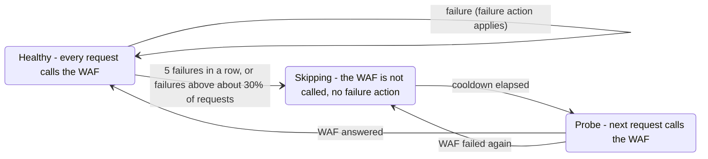

[Documentation](README.md) › When a dependency is down

# When a dependency is down

Every [leg](how-it-works.md#legs) depends on something outside Traefik: LAPI (or CAPI), AppSec, the ModSecurity sidecar, Redis, the captcha provider. This page says, for each one, what a request gets when it fails, which setting decides, what the defaults do, and how you see it. There is no global switch: each leg handles its own backend, and the other legs keep running.

- [At a glance](#at-a-glance)
- [Three rules shared by every leg](#three-rules-shared-by-every-leg)
- [LAPI](#lapi)
- [The LAPI Redis cache](#the-lapi-redis-cache)
- [When a WAF is down: failure action and backoff](#when-a-waf-is-down-failure-action-and-backoff)
- [What AppSec and ModSec count as a failure](#what-appsec-and-modsec-count-as-a-failure)
- [The rate-limit Redis](#the-rate-limit-redis)
- [The captcha provider](#the-captcha-provider)
- [The connection is not there](#the-connection-is-not-there)
- [How you notice an outage](#how-you-notice-an-outage)

## At a glance

With the default settings:

| Backend down | What the request gets | Decided by | Default result |
| ------------ | --------------------- | ---------- | -------------- |
| LAPI, `stream` mode | Decisions already downloaded keep applying. Other clients pass until a refresh fails, then get the failure action. | [`bouncerLapiFailureAction`](configuration.md#bouncerlapifailureaction), [`lapiUpdateMaxFailure`](configuration.md#lapiupdatemaxfailure) | Ban clients without a known decision, from the first failed refresh. |
| LAPI, `live` / `none` mode | Each lookup LAPI does not answer gets the failure action. In `live`, answers already cached keep applying until they expire. | `bouncerLapiFailureAction` | Ban. |
| CAPI, `alone` mode | At startup: the middleware does not load. Later: as `stream`, and the next try is 2 hours later. | `bouncerLapiFailureAction`, `lapiUpdateMaxFailure` | Ban clients without a known decision. |
| Redis cache of LAPI (`lapiRedisEnabled`) | No fallback to memory or to LAPI. | [`bouncerRedisUnreachableBlock`](configuration.md#bouncerredisunreachableblock) | Ban (`ban:cache-fail`). |
| AppSec | The failure action; after repeated failures, AppSec is skipped for a cooldown. | [`bouncerAppsecFailureAction`](configuration.md#bouncerappsecfailureaction), [`appsecUnhealthyBackOffPeriodSecs`](configuration.md#appsecunhealthybackoffperiodsecs) | Ban the first failures, then let requests through without AppSec for 30 seconds at a time. |
| ModSecurity sidecar | The failure action. | [`bouncerModsecFailureAction`](configuration.md#bouncermodsecfailureaction), [`modsecUnhealthyBackOffPeriodSecs`](configuration.md#modsecunhealthybackoffperiodsecs) | Let the request through without CRS. |
| Redis of the rate limit | With the default sliding window, each Traefik replica keeps counting on its own. | [`rateLimitFailureAction`](configuration.md#ratelimitfailureaction), [`rateLimitSyncRate`](configuration.md#ratelimitsyncrate), [`rateLimitAlgorithm`](configuration.md#ratelimitalgorithm) | Limit per replica instead of across replicas. |
| Captcha provider | A visitor who submits the captcha gets the captcha page again. Nobody passes the captcha, nobody is banned for it. | [`captchaSiteverifyHttpTimeoutSeconds`](configuration.md#captchasiteverifyhttptimeoutseconds) | Captcha'd visitors stay blocked until the provider answers. |
| A connection no loaded middleware shares | LAPI, AppSec and ModSec apply their failure action; a captcha becomes a ban; the rate limit lets the request through. | The same failure actions | Ban on LAPI and AppSec, pass on ModSec and the rate limit. |

## Three rules shared by every leg

**1. A failure action is set per leg, and in most legs per router.** It is one of `ban`, `passthrough`, or `captcha`:

| Leg | Setting | Default | Where it is set |
| --- | ------- | ------- | --------------- |
| LAPI | `bouncerLapiFailureAction` | `ban` | Each router |
| AppSec | `bouncerAppsecFailureAction` | `ban` | Each router |
| ModSec | `bouncerModsecFailureAction` | `passthrough` | Each router |
| Rate limit | `rateLimitFailureAction` | `passthrough` | The middleware with `rateLimitEnabled`, for every router that uses the policy |

- `ban` serves the ban page with `bouncerRemediationStatusCode` (default 403), not the 429 of the rate limit, and no `Retry-After`.
- `passthrough` continues with the next check: a LAPI outage still leaves the rate limit, AppSec and ModSec in front of your application.
- `captcha` serves this router's captcha. A router without a usable captcha serves the ban page instead (`ban:captcha-downgrade`). A request that a [`bypassCaptcha`](how-to/captcha-off-api-routes.md) rule matches, or a visitor who already solved the captcha, goes through.

Two routers on the same LAPI, AppSec or ModSec connection can choose differently: for example `passthrough` on the public site and `ban` on the admin.

**2. A failure is not a verdict.** A failure is the backend giving no answer: unreachable, a timeout, a 5xx, a connection not published. A block is an answer, and never applies the failure action: AppSec saying `ban`, the sidecar answering 3xx or 4xx, a LAPI ban decision. The client side is neither: a client that disconnects or sends a body that cannot be read gets `error:client-disconnected` or HTTP 400 `error:client-body-read`, with no ban and no failure action.

**3. Only the WAFs back off.** AppSec and ModSec can stop calling a backend that keeps failing (the backoff gate below). LAPI, the rate limit and the captcha provider have no gate: each request that needs them tries again, bounded by their timeout.

## LAPI

How LAPI's outage reaches a request depends on [`lapiMode`](concepts.md#lapi-modes). The timeout of one LAPI call is [`lapiHttpTimeoutSeconds`](configuration.md#lapihttptimeoutseconds) (default 10). [Choose what happens when CrowdSec is down](how-to/crowdsec-down.md) is the short how-to.

**`stream`.** Requests never call LAPI; they are checked against the decisions in memory.

- The plugin refreshes the decisions every [`lapiUpdateIntervalSeconds`](configuration.md#lapiupdateintervalseconds) (default 60), counted from the end of the previous refresh.
- A failed refresh changes nothing in memory. Decisions already downloaded keep applying until each one expires.
- After `lapiUpdateMaxFailure` + 1 failed refreshes in a row (the first one, with the default `0`), the stream is **unhealthy**: a client with no known decision gets `bouncerLapiFailureAction`, with the verdict header `stream-unhealthy` (`ban:stream-unhealthy`, `captcha:stream-unhealthy`). `-1` never marks the stream unhealthy, so unknown clients keep passing.
- The first refresh that succeeds marks the stream healthy again and downloads the full decision list.
- The middleware loads even when LAPI is down at startup. Until the first refresh fails (up to `lapiHttpTimeoutSeconds`), unknown clients pass.

**`live`.** Each new client is looked up in LAPI on its request, and the answer is cached for [`lapiDefaultDecisionSeconds`](configuration.md#lapidefaultdecisionseconds) (default 60).

- A lookup LAPI does not answer gets `bouncerLapiFailureAction` right away, with the verdict header `lapi-failure`. It is not cached: the client's next request asks LAPI again.
- A cached answer, including "not banned", keeps applying until it expires, without asking LAPI. During an outage, clients seen in the last minute keep their last answer.
- With [`bouncerDecisionScopeHeaders`](configuration.md#bouncerdecisionscopeheaders), each mapped header is one more lookup. When one of them fails and no other lookup found a ban or a captcha, the failure action applies. A ban or a captcha found by any lookup wins over the failure.

**`none`.** Like `live`, without a cache: every request asks LAPI, and every request LAPI does not answer gets the failure action.

**`alone`.** The decisions come from CAPI, without a local CrowdSec.

- The plugin logs in to CAPI when the middleware loads. If CAPI cannot be reached then, the middleware fails to load (ERROR `startStream:getToken`), and Traefik does not run it.
- After that, CAPI outages behave as in `stream`. The refresh interval is fixed at 2 hours in this mode, so after a failed refresh the next try is 2 hours later.

## The LAPI Redis cache

With [`lapiRedisEnabled`](configuration.md#lapiredisenabled), LAPI decisions are kept in Redis instead of memory (see [Cache](concepts.md#cache)). Every request in `live`, `stream` and `alone` reads Redis. There is no fallback: not to memory, not to LAPI.

| Redis | What the request gets |
| ----- | --------------------- |
| Cannot be reached (connection refused, no connection available) | With `bouncerRedisUnreachableBlock: true` (default): a ban, verdict header `ban:cache-fail`, reason `TECHNICAL_ISSUE`. With `false`: the LAPI check is skipped and the request goes on to the next checks. Bans stored in Redis do not apply. |
| Answers too slowly (more than about 1 second) | A ban (`ban:cache-fail`), whatever `bouncerRedisUnreachableBlock` says. |

- `bouncerLapiFailureAction` does not apply to a Redis outage.
- Reads go to [`lapiRedisReadHosts`](configuration.md#lapiredisreadhosts) in turn, and do not fall back to the primary.
- Each failed read logs ERROR `serveLAPI:Get`, once per request.

## When a WAF is down: failure action and backoff

Both WAF checks follow the same two rules.

**Failure action.** When the WAF gives no verdict (unreachable, timeout, 5xx, or no connection published yet), the router applies its failure action: `ban`, `passthrough`, or `captcha`.

| | AppSec | ModSec |
| --- | --- | --- |
| Setting (per router) | `bouncerAppsecFailureAction` | `bouncerModsecFailureAction` |
| Default | `ban` | `passthrough` |
| Verdict header | `ban:appsec-failure` / `captcha:appsec-failure` | `ban:modsec-failure` / `captcha:modsec-failure` |

**Backoff gate.** Without it, every request during an outage waits for the timeout and then gets the failure action. With it, the plugin stops calling a WAF that keeps failing:

| | AppSec | ModSec |
| --- | --- | --- |
| Cooldown (on the connecting middleware) | `appsecUnhealthyBackOffPeriodSecs` | `modsecUnhealthyBackOffPeriodSecs` |
| Default | `30` (on) | `0` (off) |

- While the gate skips a WAF, requests continue as if that WAF were not configured: no call and no failure action. The other checks still run, so with both WAFs on one router, an AppSec outage still leaves CRS in front of your application, and the other way round.
- A failed request before the trip still gets the failure action. With `ban`, a short outage bans the first few requests, then lets traffic through until the WAF is back. To keep the failure action on every request for the whole outage, set the cooldown to `0`.
- The trip rule is fixed: each failure spends one unit of a budget of 5, each answered request earns back part of one.
- One line per transition, not one per request: `crowdsec appsec backoff started` / `crowdsec modsec backoff started` (WARN, with `retryIn`), and `crowdsec appsec backoff ended` / `crowdsec modsec backoff ended` (INFO) when a probe succeeds. Alert on the WARN line.

The real-stack tests (`tests/e2e/real/waf_backoff.Tests.ps1`) stop a WAF container, check each step above, start it again, and check the recovery.

## What AppSec and ModSec count as a failure

| Answer | AppSec | ModSec |
| ------ | ------ | ------ |
| Allow | HTTP 200 with no action or `allow` | 2xx |
| Block (a verdict, never the failure action) | HTTP 403, or a 200 whose action is `ban`, `captcha` or a challenge. A 403 AppSec sends without a readable action is still a ban (`ban:appsec-failure`), even with `passthrough`. | 3xx or 4xx, including a 413 of the sidecar's own body limit |
| Failure (the failure action, and one failure for the backoff gate) | 500 and any status other than 200, 401 and 403; a timeout; a refused connection, a DNS or TLS error; a response that cannot be read | 5xx; a timeout; a refused connection, a DNS or TLS error |
| Failure that does not count for the gate | HTTP 401 (a wrong `appsecKey`): the failure action applies on every request, and the gate stays closed, because the listener answered | — |
| Not called | Body over `appsecBodyLimit`: only the first bytes are sent, not a failure | Body over [`modsecBodyLimit`](configuration.md#modsecbodylimit): HTTP 413 to the client, without the failure action, also while the gate skips the sidecar |
| Not called, HTTP 400 | A body without `Content-Length` that does not arrive within [`appsecBodyReadTimeoutSeconds`](configuration.md#appsecbodyreadtimeoutseconds) (`error:body-read-timeout`) | A body without `Content-Length` that does not arrive within [`modsecBodyReadTimeoutSeconds`](configuration.md#modsecbodyreadtimeoutseconds) (`error:body-read-timeout`) |

The failure action covers only a WAF that gave no verdict. The client's own body never triggers it. A body without `Content-Length` (HTTP/1.1 chunked, or HTTP/2 and HTTP/3 without the header) is read and inspected like any other, so removing `Content-Length` no longer skips inspection on either WAF. If it does not arrive within that WAF's read timeout, the request is blocked with HTTP 400, whatever the failure action says, and also while the gate skips that WAF. A body that never ends (gRPC client streaming, for example) is always blocked: see [Run streaming request bodies through the WAF legs](how-to/streaming-request-bodies.md).

**The gate in detail.**

- One gate per connection, not per router: every router that uses the same `appsecInstanceName` or `modsecInstanceName` shares it, so failures seen by one router open it for all of them. Each Traefik replica has its own gate.
- The budget: each failure spends one unit out of 5, each answered request earns back 0.3/0.7 of one. Five failures in a row trip it from a full budget; a steady failure rate above about 30% trips it over time. The request that spends the last unit still gets the failure action; skipping starts with the next one.
- The probe: when the cooldown ends, one request calls the WAF; the others keep skipping until it answers. A probe that answers closes the gate with a full budget. A probe that fails starts another cooldown, without a new log line.
- The cooldown does not grow: every trip waits the same `*UnhealthyBackOffPeriodSecs`.
- A gate that sees no request for 60 seconds is forgotten: the next request calls the WAF as if it were healthy.
- A reload keeps the gate when the connection is kept. Changing the cooldown, the host, the timeout or the body limit opens a new connection with a closed gate. Changing only a router's failure action keeps it.

**Both WAFs on one router.** They run one after the other (AppSec first) and fail independently. With AppSec's gate skipping, ModSec still inspects the request, and the other way round. With AppSec down and `bouncerAppsecFailureAction: ban`, the ban answers before ModSec runs. With ModSec down and `bouncerModsecFailureAction: ban`, an AppSec allow does not save the request.

## The rate-limit Redis

The full behavior, per algorithm and sync mode, is in [Rate limit › When Redis is down](rate-limit.md). In short:

| Policy | Redis down |
| ------ | ---------- |
| `slidingWindow` with the default `rateLimitSyncRate: 200ms` | Not a failure. Each replica keeps counting on its own, from zero for a counter it had not read yet, and answers a client over the limit on that replica. It stops calling Redis for one sync interval after a failure, then tries again. `rateLimitFailureAction` does not apply. |
| `slidingWindow` with `rateLimitSyncRate: 0` | `rateLimitFailureAction` on every counted request. |
| `tokenBucket` | `rateLimitFailureAction` on every counted request. |
| Any policy, Redis slower than 250 ms for the whole request | `rateLimitFailureAction` for the buckets reached after those 250 ms, even when an earlier `captcha` bucket was already over its limit. |

- The middleware with `rateLimitEnabled` loads even when Redis is down at startup; the outage shows on the first request.
- So `rateLimitFailureAction: ban` does not make the default policy fail closed: with the buffered sliding window, an unreachable Redis only loses the count across replicas. To fail closed, also set `rateLimitSyncRate: 0` or use `tokenBucket`.
- When Redis restarts empty, sliding windows start from zero and token buckets start full: for one window, the limit is not enforced across what was counted before.
- Redis errors are logged at DEBUG only (`serveRateLimit`). At the default `INFO` level, a Redis outage leaves no log line; watch the verdict header and the `plugin:ratelimit_failure` metric instead.

## The captcha provider

The plugin calls the provider only when a visitor submits the captcha form, never to show the page. The call has its own timeout, [`captchaSiteverifyHttpTimeoutSeconds`](configuration.md#captchasiteverifyhttptimeoutseconds) (default 10), and is not retried.

When the provider does not answer, answers with an error page, or answers something that is not JSON, the visitor gets the captcha page again (HTTP 200) and can try once more. The visitor is not let through and not banned. Only a valid `success: true` sets the captcha cookie.

- Visitors who already solved a captcha keep passing for [`captchaGracePeriodSeconds`](configuration.md#captchagraceperiodseconds): their pass is a signed cookie, checked without the provider.
- A failure action set to `captcha` therefore blocks during a provider outage too: the visitor can see the captcha but cannot solve it.
- An unreachable provider logs INFO `captcha:ServeHTTP:validate` with the error, once per submit.

## The connection is not there

A router that names an instance no loaded middleware shares runs that leg without a connection. That happens with a typo in the name, before the middleware that connects is loaded (at startup, on a reload, or from another provider), and after it is removed from the configuration (once [`reclaimGraceSeconds`](configuration.md#reclaimgraceseconds) runs out).

| Leg | What the request gets | Verdict header | Log |
| --- | --------------------- | -------------- | --- |
| LAPI | `bouncerLapiFailureAction` (default ban) | `lapi-failure` | None per request |
| AppSec | `bouncerAppsecFailureAction` (default ban) | `appsec-failure` | None per request |
| ModSec | `bouncerModsecFailureAction` (default pass) | `modsec-failure` | None per request |
| Captcha | Any captcha this router should serve becomes a ban | `ban:captcha-downgrade` | None per request |
| Rate limit | Passes: nothing is counted, no failure action | None | WARN `crowdsec bouncer rate limit owner unavailable` once, INFO `crowdsec bouncer rate limit owner available` when it is back |

The rate limit differs because its failure action is part of the policy, and without the middleware that holds the policy there is none to apply.

A misspelled `lapiInstanceName` or `appsecInstanceName` bans every request of that router with the default failure actions, and only the verdict header says why. When you add a router, set `bouncerRemediationHeadersCustomName` and check its first responses. [Middleware architecture](middleware-architecture.md) shows how to keep the window after startup short.

## How you notice an outage

| Backend | Log at the default `INFO` level | Verdict header | CrowdSec metric origin |
| ------- | ------------------------------- | -------------- | ---------------------- |
| LAPI (`stream`, `alone`) | WARN `handleStreamTicker` per failed refresh; INFO `crowdsec stream became unhealthy` and ERROR `handleStreamTicker:error` once; INFO `crowdsec stream became healthy` on recovery | `stream-unhealthy` | `plugin:tech_streamfail` |
| LAPI (`live`, `none`) | None (DEBUG `serveLAPI:LiveLookup`) | `lapi-failure` | `plugin:lapi_failure` |
| LAPI Redis cache | ERROR `serveLAPI:Get` per request | `cache-fail` | `plugin:tech_cachefail` |
| AppSec | ERROR `appsecQuery:unreachable` per unreachable call, with the transport error in `error`; INFO `appsecQuery:failure` at most every 5 seconds for a 500 (`statusCode`), and per response-body read error (`error`); WARN `crowdsec appsec backoff started` and INFO `crowdsec appsec backoff ended` per trip | `appsec-failure` | `plugin:appsec_failure` |
| ModSec | ERROR `crowdsec modsec sidecar unavailable`, debounced, with `reason` plus the transport error in `error` or the `statusCode`; WARN `crowdsec modsec backoff started` and INFO `crowdsec modsec backoff ended` per trip | `modsec-failure` | `plugin:modsec_failure` |
| Rate-limit Redis | None (DEBUG `serveRateLimit`) | `ratelimit-failure` | `plugin:ratelimit_failure` |
| Captcha provider | INFO `captcha:ServeHTTP:validate` per failed submit | None | None |

- The verdict header is only sent when [`bouncerRemediationHeadersCustomName`](configuration.md#bouncerremediationheaderscustomname) is set, and only when the failure action is `ban` or `captcha`. A `passthrough`, and a request the backoff gate let through, carry no header. See [See the verdict in access logs](how-to/verdict-in-access-logs.md).
- Metrics are reported to CrowdSec only by a router that has a LAPI connection, and only for a ban or a captcha. See [LAPI metrics reporting](concepts.md#lapi-metrics-reporting).
- The ban template gets `{{ .RemediationReason }}`: `TECHNICAL_ISSUE` for an unhealthy stream or a Redis cache failure, `LAPI`, `APPSEC`, `MODSEC` or `RATE_LIMIT` for the failure action of that leg. See [Put a request id on the ban page](how-to/request-id-on-ban-page.md).
- Alert on the WARN backoff lines and on the `stream became unhealthy` line. For the rate limit and LAPI in `live` or `none`, alert on the metric or on the verdict header in your access logs.
