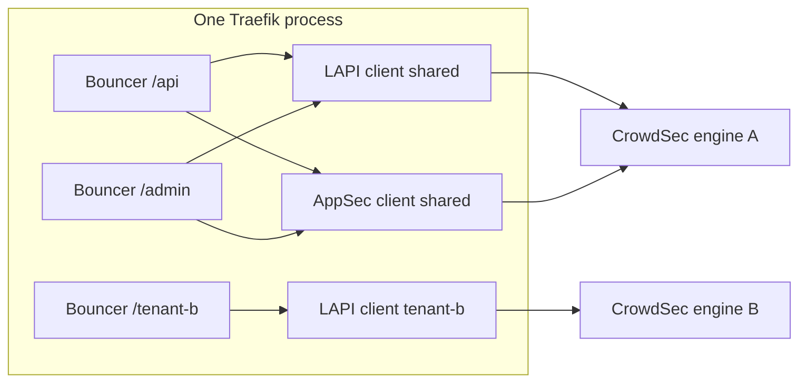

[Documentation](README.md) › Middleware architecture

# Middleware architecture

Most installs need a single middleware with everything enabled (see [One middleware](#one-middleware-all-in-one)). Read the rest of this page if you protect several routers with different settings, or use several CrowdSec engines.

A middleware can do two jobs:

1. **Connect** to CrowdSec. Each connection is turned on separately and is shared under a name, which defaults to the middleware's own name:

   | Connection | Turn on with | Shared as |
   | ---------- | ------------ | --------- |
   | LAPI (decisions) | `lapiEnabled: true` | `lapiInstanceName` |
   | AppSec (WAF) | `appsecEnabled: true` | `appsecInstanceName` |
   | Captcha provider | `captchaEnabled: true` | `captchaInstanceName` |

2. **Protect** the router it is attached to (`bouncerEnabled: true`), using the connections it names.

A middleware that only protects sets `bouncerEnabled: true` plus the instance names it wants to use, and leaves the `*Enabled` connection flags off. It does not repeat the host, key, or interval: those live on the middleware that connects. It keeps its own request settings (status code, captcha, trusted IPs, behavior when CrowdSec is down, response headers). LAPI, AppSec, and captcha names are independent, so all three can be called `shared`.



Right after Traefik starts or reloads, a connection can take a moment to become available. Until it does, a request that needs that connection uses the configured failure action.

The settings involved are listed in [Configuration › Connections and sharing](configuration.md#connections-and-sharing).

## One middleware (all-in-one)

No instance names needed: the middleware connects and protects on its own.

```yaml
api-crowdsec:
  plugin:
    bouncer:
      appsecEnabled: true
      appsecKey: "..."
      bouncerEnabled: true
      lapiEnabled: true
      lapiHost: crowdsec:8080
      lapiKey: "..."
      lapiMode: stream
```

## Shared connection, per-router settings

`cs` connects to LAPI and AppSec and shares both as `shared`. `cs-admin` reuses them and only adds its own setting.

```yaml
cs:
  plugin:
    bouncer:
      appsecEnabled: true
      appsecInstanceName: shared
      appsecKey: "..."
      bouncerEnabled: true
      lapiEnabled: true
      lapiHost: crowdsec:8080
      lapiInstanceName: shared
      lapiKey: "..."
      lapiMode: stream
cs-admin:
  plugin:
    bouncer:
      appsecInstanceName: shared
      bouncerEnabled: true
      bouncerRemediationHeadersCustomName: x-crowdsec
      lapiInstanceName: shared
```

If you prefer the connections to live in a middleware that protects nothing, set `bouncerEnabled: false` on it. It still has to be attached to some router, or Traefik never loads it.

```yaml
cs-holders:
  plugin:
    bouncer:
      appsecEnabled: true
      appsecInstanceName: shared
      appsecKey: "..."
      bouncerEnabled: false
      lapiEnabled: true
      lapiHost: crowdsec:8080
      lapiInstanceName: shared
      lapiKey: "..."
      lapiMode: stream
```

## Several LAPI streams or CrowdSec engines

CrowdSec tracks one stream per combination of **bouncer API key and the IP Traefik connects from**. Two LAPI connections with the same key from the same Traefik interfere with each other. Each separate stream needs its own bouncer key (and its own host if it is another engine).

Give each connection its own name, and point each protecting middleware at the one it should use:

```yaml
cs-a:
  plugin:
    bouncer:
      bouncerEnabled: true
      lapiEnabled: true
      lapiHost: crowdsec-a:8080
      lapiInstanceName: engine-a
      lapiKey: "key-a"
      lapiMode: stream
cs-b:
  plugin:
    bouncer:
      bouncerEnabled: true
      lapiEnabled: true
      lapiHost: crowdsec-b:8080
      lapiInstanceName: engine-b
      lapiKey: "key-b"
      lapiMode: stream
app-a:
  plugin:
    bouncer:
      bouncerEnabled: true
      lapiInstanceName: engine-a
app-b:
  plugin:
    bouncer:
      bouncerEnabled: true
      lapiInstanceName: engine-b
```

`app-a` and `app-b` run in the same Traefik but see different decisions. The same pattern works for two streams from one engine, using two bouncer keys.

## AppSec only

No decision lookup; only the WAF.

```yaml
waf:
  plugin:
    bouncer:
      appsecEnabled: true
      appsecHost: crowdsec:7422
      appsecKey: "..."
      bouncerEnabled: true
      lapiEnabled: false
```
