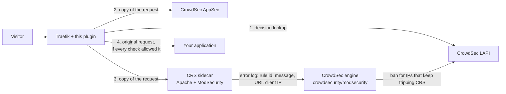

[Documentation](README.md) › ModSecurity (OWASP CRS)

# ModSecurity (OWASP CRS)

Optional. Next to CrowdSec AppSec, the plugin can send each request to an [OWASP CRS](https://coreruleset.org/) container that runs ModSecurity: the **sidecar**. Use it when you want the full ModSecurity engine and CRS tuning (paranoia level, anomaly threshold, your own `SecRule`s and exclusions) at the edge. Decisions, AppSec, captcha, and CRS then live in one middleware; you do not need a second WAF plugin. A complete, runnable setup is in [examples/modsecurity](../examples/modsecurity/README.md) (`make run_modsecurity`).

## How the ModSec leg works



The checks run in that order, and the first one that blocks answers: a request AppSec blocks never reaches the sidecar. When the router applies a [rate limit](rate-limit.md), it runs between steps 1 and 2. `bouncerClientTrustedIps` skips all of them. `bypassModsec` in [BouncerActionRules](configuration.md#bounceractionrules) skips only the sidecar; `bypass` skips LAPI, AppSec, and the sidecar, not the rate limit. The full order is in [Order of the checks](how-it-works.md#order-of-the-checks).

The sidecar only inspects. After the CRS request phases (headers and body), Apache answers HTTP 200 itself; it never proxies to your application. The plugin reads its status:

| Sidecar answer | What the plugin does | Verdict header |
| --- | --- | --- |
| 2xx | Continues to your application. | none |
| 3xx or 4xx | Blocks. The visitor gets the sidecar's response: its status, its page, and its headers except hop-by-hop ones and `Server`. Redirects are not followed. | `ban:modsec` |
| 5xx, timeout, or unreachable | No verdict: applies `bouncerModsecFailureAction`, or `bouncerModsecBackOffAction` while the backoff gate skips the sidecar (see [When a WAF is down](failure-modes.md#when-a-waf-is-down-failure-action-and-backoff)). | `ban:modsec-failure`, `captcha:modsec-failure`, `ban:modsec-backoff`, `captcha:modsec-backoff`, or none |
| Not called: body over `modsecBodyLimit` | HTTP 413. | none |
| Not called: a body without `Content-Length` that does not arrive within `modsecBodyReadTimeoutSeconds` | HTTP 400, whatever `bouncerModsecFailureAction` says. | `error:body-read-timeout` |

Request bodies:

- The plugin holds the body in memory, up to `modsecBodyLimit` (8 MiB by default), sends it to the sidecar with its `Content-Length`, and hands the same bytes to your application.
- With AppSec on the same router, the body is read once and shared. `appsecBodyLimit` still cuts what AppSec sees; `modsecBodyLimit` rejects a larger body with 413.
- A body without `Content-Length` (HTTP/1.1 chunked, or HTTP/2 and HTTP/3 without the header) is read and sent to the sidecar like any other, so leaving out `Content-Length` never skips CRS. It must arrive within [`modsecBodyReadTimeoutSeconds`](configuration.md#modsecbodyreadtimeoutseconds) (30 s by default), or the request gets HTTP 400. A gRPC stream or another body that never ends is always blocked: exclude its route with a `bypassModsec` rule (see [Run streaming request bodies through the WAF legs](how-to/streaming-request-bodies.md)).
- WebSocket handshakes are inspected like any GET. After an allow, the upgraded connection goes straight to your application.

The plugin itself has no list of methods that may carry a body. CRS decides: a body on `GET` or `HEAD` is blocked by rules 920170 and 920171 at paranoia level 1, and you can add your own rule for other methods (see [Tune CRS](#tune-crs)).

## What to expect (speed)

A ballpark, not a promise. Throughput of the CRS sidecar alone (HTTP 200 allow), measured for [traefik-modsecurity](https://github.com/david-garcia-garcia/traefik-modsecurity), the standalone plugin this leg replaces, with the same inspect-only setup:

| Sidecar | GET | POST |
| --- | --- | --- |
| Apache | ~5200 req/s (10 ms) | ~1350 req/s (37 ms) |
| nginx | ~3600 req/s (14 ms) | ~2550 req/s (20 ms) |

Every inspected request costs one more HTTP round trip from Traefik to the sidecar. Large bodies cost much more: on the e2e stack, CRS at paranoia level 1 took about 0.04 s for a 10 KB JSON body and about 3.3 s for a 100 KB one. So:

- Keep `modsecBodyLimit` close to what your application really accepts.
- Keep `modsecHttpTimeoutSeconds` above the time CRS needs for your largest body. A timeout is a failure, not an allow.
- Skip upload endpoints with `bypassModsec` if CRS adds nothing there.

## Use Apache, answering itself

Use the Apache flavour of `owasp/modsecurity-crs`, with a vhost that answers 200 itself once CRS allowed the request.

- **Apache.** ModSecurity runs as an Apache module on every request. One `RewriteRule .* - [R=200]` inside `<Location />` turns an allow into a local 200 after the request phases, body included. One process, one port, no second backend.
- **nginx.** The nginx image runs ModSecurity only inside a proxied `location`, and a `return 200` there skips request-body inspection. The 200 must come from a second backend (an internal server on a Unix socket), and the image applies `REAL_IP_*` too late for ModSecurity, so the client IP needs another override at `http` level. That is three extra files to keep in sync with the image.

nginx is faster for POST in the table above. Choose it only if that matters more to you than the simpler setup; the files it needs are in [traefik-modsecurity/crs-nginx](https://github.com/david-garcia-garcia/traefik-modsecurity/tree/main/crs-nginx).

## Set it up

**1. The inspect-only vhost.** Mount [examples/modsecurity/crs-apache/httpd-vhosts.conf](../examples/modsecurity/crs-apache/httpd-vhosts.conf) over `/usr/local/apache2/conf/extra/httpd-vhosts.conf`. The lines that matter:

```apache
# Client IP in the ModSecurity logs: Traefik sends the visitor's address in X-Real-IP.
# The pinned image ignores REMOTEIP_HEADER, so set it here.
RemoteIPHeader X-Real-IP
RemoteIPInternalProxy ${REMOTEIP_INT_PROXY}

# Without these, Apache answers the tiny 200 with 304, 412, or 416,
# and the plugin treats any 3xx or 4xx as a block.
RequestHeader unset Range early
RequestHeader unset If-Range early
RequestHeader unset If-Modified-Since early
RequestHeader unset If-None-Match early

# The answer after CRS allowed the request. No ProxyPass.
<Location />
    RewriteEngine On
    RewriteRule .* - [R=200,L]
    ErrorDocument 200 "OK"
    ProxyPass !
</Location>
```

**2. The sidecar container.**

```yaml
waf:
  image: owasp/modsecurity-crs:4.3.0-apache-alpine-202406090906
  environment:
    PARANOIA: "1"
    ANOMALY_INBOUND: "5"
    ANOMALY_OUTBOUND: "4"
    # CRS allows only GET HEAD POST OPTIONS by default (rule 911100). Add what your API uses.
    ALLOWED_METHODS: "GET HEAD POST OPTIONS PUT PATCH DELETE"
    MODSEC_RULE_ENGINE: "On"
    # The image rejects a non-file body over 128 KiB with 413, which the plugin relays as a block.
    # Set both at or above modsecBodyLimit.
    MODSEC_REQ_BODY_NOFILES_LIMIT: "1048576"
    MODSEC_REQ_BODY_LIMIT: "1048576"
    MODSEC_AUDIT_ENGINE: "Off"
    # Networks Traefik reaches the sidecar from. Never 0.0.0.0/0.
    REMOTEIP_INT_PROXY: "10.0.0.0/8 172.16.0.0/12 192.168.0.0/16"
  volumes:
    - ./crs-apache/httpd-vhosts.conf:/usr/local/apache2/conf/extra/httpd-vhosts.conf:ro
    - ./crs-rules/REQUEST-900-EXCLUSION-RULES-BEFORE-CRS.conf:/etc/modsecurity.d/owasp-crs/rules/REQUEST-900-EXCLUSION-RULES-BEFORE-CRS.conf:ro
```

Do not publish its port: only Traefik talks to it.

**3. The middleware.** `modsecEnabled` and `modsecUrl` go on the middleware that connects; other routers reuse the connection by name and keep their own failure action.

```yaml
http:
  middlewares:
    # Connects to LAPI, AppSec, and the sidecar, and protects its own router.
    crowdsec:
      plugin:
        bouncer:
          bouncerEnabled: true
          bouncerRemediationHeadersCustomName: X-Crowdsec-Remediation
          lapiEnabled: true
          lapiHost: crowdsec:8080
          lapiInstanceName: shared
          lapiKey: "..."
          lapiMode: stream
          appsecEnabled: true
          appsecHost: crowdsec:7422
          appsecInstanceName: shared
          modsecEnabled: true
          modsecInstanceName: shared
          modsecUrl: http://waf:8080
          modsecBodyLimit: 1048576
          modsecUnhealthyBackOffPeriodSecs: 30
    # Reuses the three connections. A sidecar outage bans here instead of letting the request through.
    crowdsec-admin:
      plugin:
        bouncer:
          bouncerEnabled: true
          bouncerModsecFailureAction: ban
          bouncerModsecBackOffAction: ban
          bouncerRemediationHeadersCustomName: X-Crowdsec-Remediation
          lapiInstanceName: shared
          appsecInstanceName: shared
          modsecInstanceName: shared
```

The ModSec leg works without LAPI or AppSec too: `lapiEnabled: false` with only the `modsec*` keys.

**4. Check it.**

```bash
curl -i "http://localhost:8000/?file=../../etc/passwd"   # 403, X-Crowdsec-Remediation: ban:modsec
curl -i http://localhost:8000/                          # 200, no header
```

## Tune CRS

Most tuning is environment variables of the image (`PARANOIA`, `ANOMALY_INBOUND`, `ALLOWED_METHODS`, `MODSEC_REQ_BODY_*`, …). For your own rules and exclusions, mount a file over `/etc/modsecurity.d/owasp-crs/rules/REQUEST-900-EXCLUSION-RULES-BEFORE-CRS.conf` (runs before CRS) or `RESPONSE-999-EXCLUSION-RULES-AFTER-CRS.conf` (after). The image loads every `*.conf` in that folder. Use ids from 1000000 upwards.

```apache
# Reject a body on DELETE and OPTIONS. CRS already blocks a body on GET and HEAD.
SecRule REQUEST_METHOD "@rx ^(?:DELETE|OPTIONS)$" \
    "id:1000100,phase:1,deny,status:400,log,msg:'Request body not allowed on this method',chain"
    SecRule REQUEST_HEADERS:Content-Length "!@rx ^0?$" "t:none"

# Exception: /api/search takes a GET with a JSON body. Only rule 920170, only on that path.
SecRule REQUEST_URI "@beginsWith /api/search" \
    "id:1000200,phase:1,pass,nolog,ctl:ruleRemoveById=920170"
```

The 400 of the first rule reaches the visitor as a block (`ban:modsec`), like any 4xx from the sidecar. Raise the paranoia level or lower the anomaly threshold only after watching the log for false positives.

## Read why a request was blocked

The plugin only learns allow or block. The details are in the sidecar's error log, one line per rule that matched, then one `Access denied` line:

```text
[...] [security2:error] [...] [client 203.0.113.7] ModSecurity: Warning. Pattern match "..." at ARGS:file. [file ".../REQUEST-930-APPLICATION-ATTACK-LFI.conf"] [line "86"] [id "930110"] [msg "Path Traversal Attack (/../) or (/.../)"] [...] [uri "/"] [unique_id "avtUb94RHragih0miJe3pAAAAEI"]
[...] [security2:error] [...] [client 203.0.113.7] ModSecurity: Access denied with code 403 (phase 2). Operator GE matched 5 at TX:blocking_inbound_anomaly_score. [...] [id "949110"] [msg "Inbound Anomaly Score Exceeded (Total Score: 10)"] [...] [uri "/"] [unique_id "avtUb94RHragih0miJe3pAAAAEI"]
```

`id` and `msg` name the rule, `uri` the path, `unique_id` ties the lines of one request together, and `[client ...]` is the visitor (only when `RemoteIPHeader` is set as above; otherwise it is Traefik).

Parse these logs. Two uses:

- **Tuning.** Group by `id` to find false positives, then write an exclusion for that rule and path.
- **Banning.** Let CrowdSec read them with the [crowdsecurity/modsecurity](https://app.crowdsec.net/hub/author/crowdsecurity/collections/modsecurity) collection. Its scenario turns repeated CRS hits from one IP into a CrowdSec decision, and from then on the plugin bans that IP at the LAPI check, before any WAF runs. With the sidecar in Docker:

  ```yaml
  # acquis.yaml on the CrowdSec engine (the engine needs the Docker socket)
  source: docker
  container_name:
    - waf
  labels:
    type: modsecurity
  ```

  `cscli metrics show acquisition` then shows a `docker:waf` source with its lines parsed.

## When the sidecar is down

A 5xx, a timeout, or an unreachable sidecar is a failure, not a block: the router applies `bouncerModsecFailureAction` (default `passthrough`). After 5 failures in a row, the backoff gate (`modsecUnhealthyBackOffPeriodSecs`, 10 seconds by default, `0` to turn it off) stops calling the sidecar for the cooldown, and the router applies `bouncerModsecBackOffAction` (default `passthrough`). See [When a WAF is down: failure action and backoff](failure-modes.md#when-a-waf-is-down-failure-action-and-backoff) and the [ModSecurity settings](configuration.md#modsecurity).
